# Hi, I'm Erick 👨🏾‍💻

**`Digital Craftsman (Engineer/Technologist/Enthusiast)`**

---
# About Me 😎
I'm a senior full stack engineer with a passion for creating quality software to solve problems and generally just for fun. We live in a time, where tech is expanding in every direction exponentially and it's exciting! Well, that is until LLMs reach AGI and erases all humans (see Terminator or iRobot 😵) jk. 

I've had a passion for software from a young age; Whether it was rooting Andriods to customize the os, to being the token "IT Specialist" for all of my families tech needs (mostly wifi configs || random devices). 

I really grasped the possibilities of software during my time in college, okstate (Go Pokes!), where I had the opportunity to learn and work with great people. In this giant sea of tech, I'm thrilled to be able to learn and build impactful software. I thrive in novel, challenging, and innovative areas. If you have any cool projects or opportunities please reach out and let's build something great together!

  

---
# Languages and Tools 🧰

  
  &nbsp;&nbsp;&nbsp;
  
  &nbsp;&nbsp;&nbsp;
  
  &nbsp;&nbsp;&nbsp;
  
  &nbsp;&nbsp;&nbsp;
  
  &nbsp;&nbsp;&nbsp;
  
  &nbsp;&nbsp;&nbsp;
  
  &nbsp;&nbsp;&nbsp;
  
  &nbsp;&nbsp;&nbsp;
  
  &nbsp;&nbsp;&nbsp;
  
  &nbsp;&nbsp;&nbsp;
  
  &nbsp;&nbsp;&nbsp;
  
  &nbsp;&nbsp;&nbsp;
  
  &nbsp;&nbsp;&nbsp;
  
  &nbsp;&nbsp;&nbsp;
  

---
# Github Stats 📊

    

